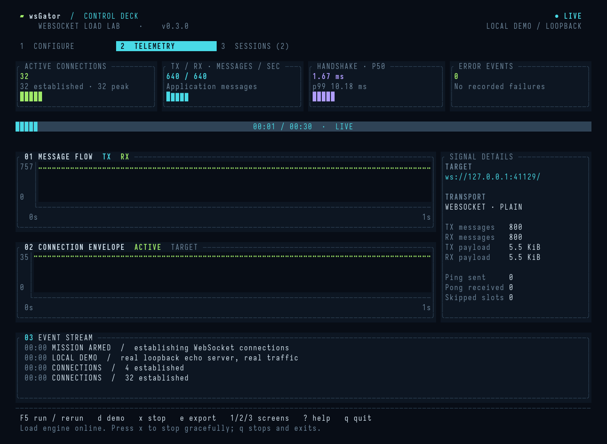

# wsGator

A WebSocket load-testing control deck, written in Rust. Configure a mission, watch live telemetry, inspect results, and launch the next run without leaving the terminal. A headless CLI is included for scripts and CI.

[](https://github.com/CanisLegatus/wsGator/actions/workflows/ci.yml)
[](LICENSE)

## Scope

Version 0.3 provides a persistent Ratatui + Crossterm interface and a single-machine flat-load engine with three client behaviors:

| Command | Behavior | Controls |
| --- | --- | --- |
| `silent` | Keeps the socket open, reads incoming messages, and answers server Ping frames. Sends no application messages. | Connection count, run duration, connection/write/close timeouts |
| `ping-pong` | Sends WebSocket Ping frames, waits for matching Pong payloads, and measures RTT. At most one Ping is outstanding per client. | `--interval`, `--timeout`, common connection controls |
| `flood` | Sends text or binary messages at a configured rate and reads incoming traffic. | `--rate`, `--message` or `--payload-file`, `--binary`, common connection controls |

All modes support `ws://`, verified `wss://`, custom HTTP headers, a WebSocket subprotocol, bounded shutdown, terminal summaries, and JSON reports. Each client owns its connection until shutdown completes; there are no detached reader or writer tasks.

## Install

Requires Rust **1.88+** and a native build toolchain (a C compiler is needed for the TLS dependency).

```sh
git clone https://github.com/CanisLegatus/wsGator.git
cd wsGator
cargo install --path wsgator --locked
wsgator --help
```

Alternatively, run from the repository:

```sh
cargo run --release -- silent --url ws://127.0.0.1:9001 -c 100 -d 30s
```

## Interactive control deck

```sh
cd wsGator
cargo run --release
# Or, after installation:
wsgator
```

The application stays open after each mission. Press **`d`** for a local demo: wsGator starts an owned loopback echo server and sends real WebSocket traffic through it. No second terminal or external service is needed. Demo settings do not replace your saved profile.



- **Configure:** select Silent, Ping-pong, or Flood; edit the endpoint, connection count, duration, and behavior settings. A load preview shows the requested profile before launch.
- **Telemetry:** live connection counts, interval TX/RX rates, handshake or Ping RTT, error counts, traffic and connection graphs, and an event stream. Ping-pong displays control-frame rates; Flood displays application-message rates.
- **Sessions:** retain the last 20 reports and their charts while the app is open. Inspect or rerun a session with its original settings, or export JSON without overwriting an existing file.

| Key | Action |
| --- | --- |
| `1` / `2` / `3` | Configure / Telemetry / Sessions |
| `Tab`, `Shift+Tab`, `↑`, `↓` | Select a setting or session |
| `←`, `→`, `m` | Switch load behavior on the Configure screen |
| `Enter` | Edit a setting, accept an edit, or inspect a session |
| `Ctrl+U` / `Esc` | Clear the edited field / cancel the edit |
| `a` | Toggle advanced connection settings |
| `F5`, `r` | Start or rerun a mission |
| `d` | Start a local demo |
| `x`, `F6` | Stop the current mission and drain its clients |
| `e` | Export selected results to `wsgator-report-<timestamp>.json` in the current directory |
| `?`, `F1` | Open the keymap |
| `q`, `Ctrl+C` | Drain active clients and exit |

Tabs, behavior cards, and fields are clickable. Mouse wheel navigation and bracketed paste are supported. Settings remain locked while a mission is running. The layout adapts to terminal resizing; minimum size is **72 × 24**, with **120 × 40** recommended for the full dashboard. Truecolor terminals display the dark neon theme; `NO_COLOR` is respected.

TLS settings, HTTP headers, subprotocols, and connection timeouts are available under advanced settings. For multiple HTTP headers, separate entries with literal `\n`, for example `Authorization: Bearer TOKEN\nX-Test: yes`.

Settings are restored from the operating system's user configuration directory (`wsgator/profile.json` under `$XDG_CONFIG_HOME` or `~/.config` on Linux). Header values, message text, and URL query parameters are session-only and excluded from the profile. Session history is in memory; export JSON for durable reports.

```sh
# Explicit interactive mode with connection settings supplied on launch.
wsgator tui --url wss://example.com/socket -c 200 -d 1m

# Start with defaults and leave local profiles untouched.
wsgator tui --no-profile
```

## Headless quick start

Start the included local echo server in another terminal:

```sh
cargo run --release -p ws-mini-server -- --bind 127.0.0.1:9001
```

Then choose a behavior:

```sh
# Keep 100 connections open for a 30-second observation window.
wsgator silent --url ws://127.0.0.1:9001 -c 100 -d 30s --progress

# Ping every second; fail a client if its matching Pong takes more than 3 seconds.
wsgator ping-pong --url ws://127.0.0.1:9001 -c 100 -d 30s \
  --interval 1s --timeout 3s

# Each of 50 clients sends up to 20 messages/second: nominal total 1,000/s.
wsgator flood --url ws://127.0.0.1:9001 -c 50 -d 30s \
  --rate 20 --message '{"event":"load-test"}' --json report.json

# Reuse the exact bytes from a file for every binary message.
wsgator flood --url ws://127.0.0.1:9001 -c 10 -d 1m \
  --rate 5 --payload-file payload.bin --binary
```

Use `wsgator <command> --help` for behavior options. Common options work before or after the command.

### TLS, authentication, and subprotocols

```sh
wsgator silent --url wss://example.com/socket -c 100 -d 1m \
  --header 'Authorization: Bearer YOUR_TOKEN' \
  --subprotocol example.v1

# Add a private CA without disabling certificate or hostname verification.
wsgator ping-pong --url wss://localhost:9443/socket --ca-cert local-ca.pem
```

Headers are repeatable. Reserved WebSocket handshake headers are generated by the client; use `--subprotocol` for protocol negotiation. The server must select the offered subprotocol. Public CA roots are bundled; `--ca-cert` adds PEM certificates. HTTP redirects and automatic reconnection are not supported.

## Load and timing semantics

- `--connections` (`-c`, default `100`) is the number of clients scheduled once. Failed clients are not replaced.
- `--duration` (`-d`, default `30s`) is the **whole observation window**, including connection setup. It starts after local payload/CA preparation. Clients that connect later have less time to exchange traffic.
- Handshakes run concurrently, limited by `--connect-concurrency` (default `256`). `--connect-timeout` (default `10s`) covers DNS, TCP, TLS, and WebSocket negotiation after a client gets a handshake slot.
- At the deadline, queued and connecting clients are cancelled; active clients perform a bounded close handshake. Shutdown drain time is reported separately from the load duration. A run that cannot attempt all clients or still has pending handshakes at its deadline is marked `load_incomplete`.
- The observation window remains open even if every client fails early, so failure runs use the same configured time window.
- Flood's `--rate` is **per connected client**, with the first message sent immediately. Scheduling and backpressure can reduce the achieved rate. Missed send slots are skipped and counted; the generator does not compensate with catch-up bursts.
- Ping-pong sends its first Ping immediately. If a Pong takes longer than the interval, the next Ping waits for it. Only a matching Pong completes an RTT sample; an unrelated Pong does not reset the timeout.
- `--write-timeout` defaults to `5s`; `--close-timeout` defaults to `2s`. Durations accept units such as `250ms`, `30s`, and `2m` (range: `1ms` to `7days`).
- Ctrl+C cancels connection setup, closes active clients, waits for their tasks, and writes a partial report.

The default incoming message/frame limit is 1 MiB (`--max-message-bytes`). Flood payloads are limited to 16 MiB, loaded once, and shared by clients. Text payload files must contain valid UTF-8. WebSocket read/write buffers start at 16 KiB per connection and can grow to accommodate messages.

## Reports and automation

The terminal summary includes successful and peak active connections, application message/byte counts, achieved rates, error categories, and handshake/Ping RTT percentiles. `--progress` prints one status update per second to stderr.

```sh
# Human summary on stdout; JSON in a file.
wsgator flood -c 20 -d 10s --rate 10 --json report.json

# JSON only on stdout; human summary on stderr.
wsgator ping-pong -c 20 -d 10s --json - > report.json
```

JSON has a versioned schema (`schema_version: 1`) and includes:

- Run settings: target, behavior, durations, timeouts, connection concurrency, message limit, payload size, rate, and heartbeat settings.
- Connection accounting: `attempted`, `connected`, `peak_active`, `completed`, `active_at_end`, `cancelled_connects`, and `not_attempted`.
- Application traffic: `messages_sent`, `messages_received`, `bytes_sent`, `bytes_received`, and rates over the load duration.
- Control traffic: Ping/Pong counters, `pending_pings_at_stop`, and `ping_rtt`.
- `handshake` and `ping_rtt`: sample count, min, mean, p50, p95, p99, and max in milliseconds. Empty measurements are `null`. Histograms use microsecond resolution, three significant digits, and bounded memory.
- `errors`: category-to-count mapping. Handshake failures, early server closes, protocol errors, missing Pongs, write/close timeouts, and incomplete load are failures.

Message and byte counters cover completed application sends and received text/binary payloads during client sessions; they exclude protocol overhead and shutdown drain traffic. Pong counters include unsolicited Pongs; RTT samples only include matching responses. An in-flight Ping cancelled by the run deadline is counted separately and is not a Pong timeout. Ping RTT measures the WebSocket heartbeat, not application processing latency.

Header values, payload contents, and URL query strings are omitted from reports. Error categories do not include server response bodies. `target` retains the URL path; avoid putting secrets in path segments. Command-line secrets may still be visible in your shell history and process list.

| Exit code | Meaning |
| --- | --- |
| `0` | Completed observation window without recorded failures |
| `1` | Completed with connection, traffic, shutdown, or incomplete-load failures |
| `2` | Invalid arguments, local setup failure, or report output failure |
| `130` | Interrupted by Ctrl+C; partial report emitted if output succeeds |

## Limits

This version implements flat load only. It does not implement ramp-up curves, waves, distributed workers, application login/subscription scripts, Socket.IO, WAMP, or automatic reconnects. The earlier experimental runner/behavior CLI has been replaced by the three headless commands above.

Achievable concurrency and traffic depend on the generator's CPU, memory, network, file descriptor limits, and available local ports. A requested rate is a scheduling target, not a throughput guarantee. No fixed connection-capacity or latency claims are made without a reproducible benchmark.

## Development

```sh
cargo fmt --all --check
cargo clippy --workspace --all-targets --locked -- -D warnings
cargo test --workspace --locked

# Unix: exercise the actual terminal application against a local echo server.
cargo build --workspace --locked
python3 -m pip install pyte==0.8.2
python3 scripts/tui_smoke.py
```

Integration tests use local servers to exercise all three behaviors, heartbeat correlation and timeouts, text/binary payloads, HTTP authentication, subprotocol negotiation, verified TLS, handshake failures, message limits, early disconnects, bounded shutdown, JSON output, and process exit codes. Unix tests also exercise Ctrl+C. TUI tests cover shared validation, Unicode editing, profiles, bounded histories, reruns, and layouts at multiple sizes. A real PTY smoke test exercises the default launch, keyboard editing, live traffic, export, history, stop/rerun, the built-in demo, OS interrupts, and terminal restoration. CI runs on Linux, macOS, and Windows, with a separate minimum-Rust-version job and a Linux PTY check.

`wsgator` contains the CLI and load engine. `ws-mini-server` is a local echo utility: it echoes text/binary messages, answers Ping frames, and completes close handshakes without per-message logging.

## Roadmap

- [x] Persistent interactive control deck, live charts, session logbook, and local demo
- [x] Settings profiles and JSON export from the TUI
- [x] Flat-load CLI with Silent, Ping-pong, and paced Flood behaviors
- [x] Verified TLS, headers, subprotocols, timeouts, and owned client tasks
- [x] Terminal/JSON reporting and local integration tests
- [ ] Reproducible performance benchmarks and generator resource measurements
- [ ] Ramp-up and stepped profiles with independently defined ramp/hold/drain phases
- [ ] Config files and application sequences: connect, authenticate, subscribe, send
- [ ] Application-level response correlation and latency measurements
- [ ] CI thresholds for error rates, connection targets, and latency percentiles
- [ ] Reconnect policies and reconnect-storm scenarios
- [ ] Prometheus/OpenTelemetry export
- [ ] Evaluate distributed workers after single-machine scheduling and reporting stabilize

## License

[GPL-3.0-or-later](LICENSE).
